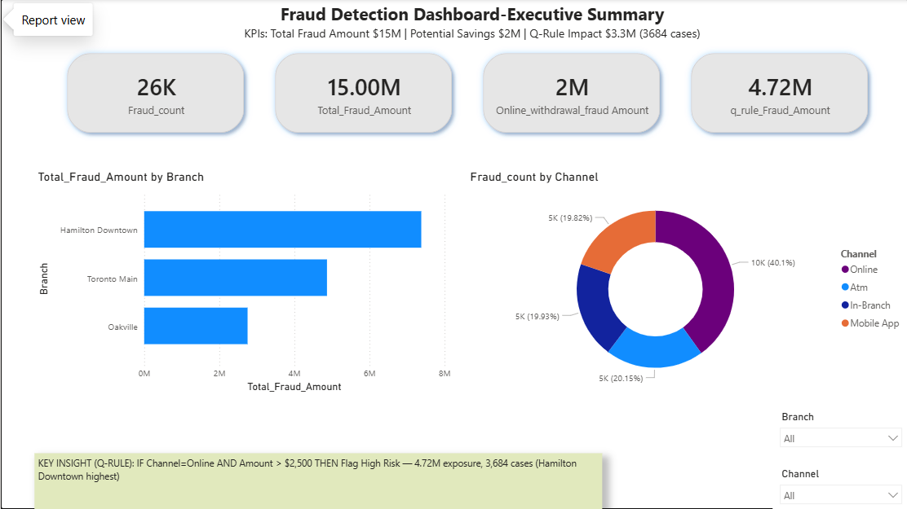
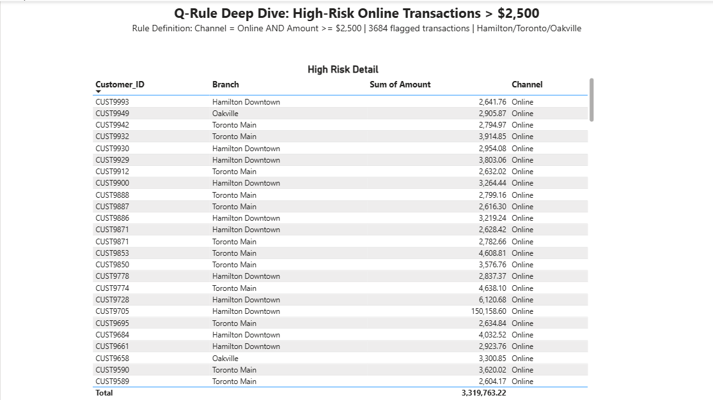

# Fraud Detection Dashboard - Power BI | GTA Branches

## Overview
Power BI dashboard built to monitor high-risk fraud transactions across GTA branches - Hamilton Downtown, Toronto Main, and Oakville. Flags high-risk online transactions for investigation.

## KPIs - Executive Summary
- **26K** - Fraud_count (Total fraudulent transactions)
- **15.00M** - Total_Fraud_Amount
- **2M** - Online_withdrawal_fraud_Amount (Potential Savings)
- **4.72M** - q_rule_Fraud_Amount (Q-Rule Impact - 3,684 cases)

## Key Insights
- Total Fraud Amount $15M | Potential Savings $2M | Q-Rule Impact $4.72M (3,684 cases)
- Hamilton Downtown has highest fraud by branch
- Online channel = 40.1% of fraud (10K cases) - riskiest channel
- Q-Rule: IF Channel = Online AND Amount > $2,500 THEN Flag High Risk - 4.72M exposure, 3,684 cases

## Visuals
- **Fraud_Amount by Branch:** Bar chart showing Hamilton Downtown ~7M, Toronto Main ~5M, Oakville ~2.5M
- **Fraud_count by Channel:** Donut chart - Online 40.1% (10K), ATM 20.15% (5K), In-Branch 19.93% (5K), Mobile App 19.82% (5K)

## Tools & DAX Used
- **Power BI Desktop**
- **DAX Measures:**
    - `Total_Fraud_Amount = SUM(Fraud_Amount)`
    - `Fraud_count = COUNT(Fraud_ID)`
    - `q_rule_Fraud_Amount = CALCULATE(SUM(Amount), Channel="Online", Amount > 2500)`
    - `Online_withdrawal_fraud_Amount = CALCULATE(SUM(Amount), Channel="Online", Type="Withdrawal")`
- **Data Cleaning:** Python (Pandas) / Power Query

## Files
- `Fraud_Detection_Dashboard.pbix` - Main Power BI file
- `/screenshots` - Dashboard screenshots

## Business Impact
This dashboard helps fraud teams prioritize investigations by focusing on Hamilton Downtown branch and Online channel, potentially saving $2M in online withdrawals.

## Author
Gloris Prema - Aspiring Data Analyst | Hamilton, ON
LinkedIn: [Add your LinkedIn link]

## Dashboard - Executive Summary

## Dashboard - Q-Rule Deep Dive

## How It Works
Q-Rule flags transactions where risk score is high and channel is online. Helps investigators prioritize cases.

## Project Link
https://github.com/glorisprema/Fraud-Detection-Dashboard-Power-BI
